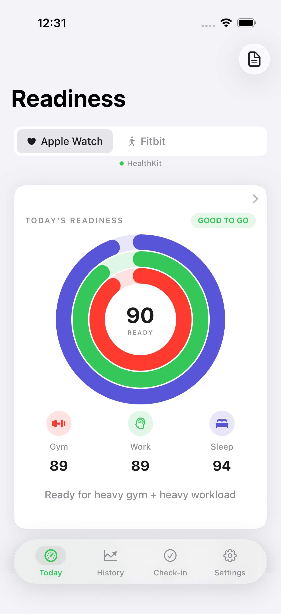

# ReadinessTracker

iOS readiness app. Bright Apple Health UI.

**Sources.** Apple Health (HealthKit) by default. Optional **Fitbit** via Google Health API (`DataSource.fitbit`; secrets in gitignored `Secrets.xcconfig`). WHOOP metrics appear when shared into Apple Health — no unofficial WHOOP OAuth.

**Today.** Gym / Work / Sleep rings + READY; check-in; recommendations. **Load Simulator** (seed from air, A/B snapshots, lever deltas, checkable air-gap tasks, lift progress gauge). **Fitbit/Health Air** (density legend + ring cycle, spark scrub/Δ vs avg, gaps + category fill gauges). **Balance Dial** zone snaps. Body tiles + Recovery / Strain / sleep stack. Tonight | Baseline cards open classic **`MetricDetailView`** (Steps-parity `*.md.nav`).

**Elsewhere.** History, Check-in, Settings. Home + Lock widgets. Watch app and complications.

**Build.**

```bash
DESTINATION='platform=iOS Simulator,name=iPhone 17 Pro' ./scripts/ci-verify.sh
```

CI: `ci-guard-tree.sh`, `ci-verify.sh`, `capture-surfaces.sh`. Screenshots under `.audit/verify-*.png`.

**Setup.** HealthKit on device. Fitbit: `Secrets.xcconfig.example` → `Secrets.xcconfig` (`FITBIT_SETUP.md`). App Group `group.com.readinesstracker`.


