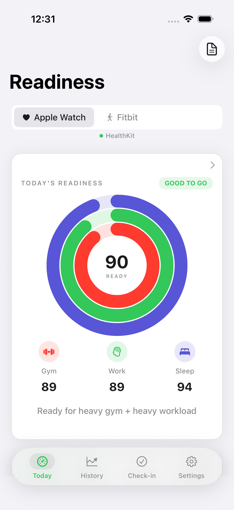

# ReadinessTracker

iOS readiness app. Bright Apple Health UI.

**Sources.** Apple Health (HealthKit) by default. Optional **Fitbit** via Google Health API (`DataSource.fitbit`; secrets in gitignored `Secrets.xcconfig`). WHOOP metrics appear when shared into Apple Health — no unofficial WHOOP OAuth.

**Today.** Gym / Work / Sleep rings + READY; check-in; recommendations. **Load Simulator** (seed from air, A/B snapshots + READY Δ gauge, lever deltas + sensitivity + polarity bars, checkable air-gap tasks, lift progress + next preview + READY ceiling + path spark + path zones + READY zones + zone jump + seedΔ + task radial + ring deltas + ring parity + composition stack + task waterfall + impact ladder + READY pace + impact share + air coverage radar + READY headroom + burn-down + GH triad + task ring mix + batch lift + seed confidence + READY momentum + zone buffer + task efficiency + READY climb + READY handoff + climb pace + climb ETA + climb surplus + climb runway + climb glide + climb intercept + climb margin + climb slack + climb overshoot + climb hold + climb ceiling + zone-banded gauge + bipolar controls + segmented task bar + WHOOP task rows). **Fitbit/Health Air** (density legend + ring cycle, spark scrub/Δ vs avg + density hist + CV + skew + IQR + percentile + envelope + MAD + Tukey fences + slope + z-score + ACF₁ + entropy + kurtosis + span + Gini + volatility + outliers + HHI + drawdown + rebound + Sharpe + Sortino + Calmar + Omega + Ulcer + Sterling + Burke + Martin + Kappa + Gain/Pain + Tail + density detail sheet (cat overlays) + Health Air Today scrub/Gain–Pain glance + cat overlays + 7/14/30d period + Health density Detail sheet + scrub readout + Health Gain/Pain meter (#628 parity) + Health Tail (#629 parity) + Health Martin (#624 parity) + Health Kappa (#627 parity) + Health Burke (#622 parity) + Health Sterling (#620 parity) + Health Ulcer (#618 parity) + Health Omega (#616 parity) + Health Calmar (#614 parity) + Health Sortino (#612 parity) + Health Sharpe (#610 parity) + Health Rebound (#608 parity) + Health Span (#596 parity) + Health Kurtosis (#594 parity) + Health Entropy (#592 parity) + Health ACF (#590 parity) + Health slope (#586 parity) + Health MAD (#582 parity) + Health envelope (#580 parity) + Health hist (#570 parity) + Health CV (#572 parity) + Health forecast bias (#568 parity) + Health forecast hitrate (#566 parity) + Health forecast residual (#564 parity) + Health forecast horizon (#562 parity) + Health forecast conf (#560 parity) + Health forecast vsmean (#558 parity) + Health spark mean (#556 parity) + Health spark range (#548 parity) + Health streak (#538 parity) + Health streak calendar (#546 parity) + Health forecast band bar (#542 parity) + Health forecast (#534 parity) + Health heat (#525 parity) + Health cycle (#521 parity) + Health stack (#529 parity) + Health wow (#527 parity) + Health heat.day (#526 parity) + Health spark (#514 parity) + Health Air strip (`health.air.strip` / #497 parity) + Health Air legend.activity (`health.air.legend.activity` / #513 parity) + Health Air legend.vitals (`health.air.legend.vitals` / #513 parity) + Health Air legend.sleep (`health.air.legend.sleep` / #513 parity) + Health Air legend.spark (`health.air.legend.spark` / #517 parity) + Health legend (#513 parity) + Health Air chip.spark.range (`health.air.chip.spark.range` / #544 parity) + Health Air chip.spark.peak (`health.air.chip.spark.peak` / #537 parity) + Health Air chip.spark.mean (`health.air.chip.spark.mean` / #536 parity) + Health Air chip.spark.delta (`health.air.chip.spark.delta` / #535 parity) + Health Air chip.spark.scrub (`health.air.chip.spark.scrub` / #532 parity) + Health Air chip.spark (`health.air.chip.spark` / #531 parity) + Health Air chip.md.nav (`health.air.chip.md.nav` / #506 parity) + Health Air spark.delta (`health.air.spark.delta` / #519 parity) + Health Air spark.extra (`health.air.spark.extra` / #510 parity) + Health Air spark.scrub (`health.air.spark.scrub` / #507 parity) + Health Air spark.metric (`health.air.spark.metric` / #505 parity) + Health Air spark.period (`health.air.spark.period` / #503 parity) + Health Air spark (`health.air.spark` / fitbit.air.spark parity) + Health Air chips (`health.air.chips` / fitbit.air.chips parity) + Health Air card (`health.air.card` / #498 parity) + Health density (`health.air.density` / fitbit.air.density parity) + Health forecast band (#540 parity) + Health Tukey (#584 parity) + Health z-score (#588 parity) + Health Skew (#574 parity) + Health IQR (#576 parity) + Health Gini (#598 parity) + Health Percentile (#578 parity) + Health Volatility (#600 parity) + Health Outliers (#602 parity) + Health HHI (#604 parity) + Health Drawdown (#606 parity) + Health gaps/category fill + forecast vs mean + confidence + 3-day horizon + residual spark + hit-rate + bias, gaps + category fill gauges). **Balance Dial** zone snaps. Body tiles + Recovery / Strain / sleep stack. Tonight | Baseline cards open classic **`MetricDetailView`** (Steps-parity `*.md.nav`).

**Elsewhere.** History, Check-in, Settings (Fitbit + Health air density ring + category fill). Home + Lock widgets. Watch app and complications.

**Build.**

```bash
DESTINATION='platform=iOS Simulator,name=iPhone 17 Pro' ./scripts/ci-verify.sh
```

CI: `ci-guard-tree.sh`, `ci-verify.sh`, `capture-surfaces.sh`. Screenshots under `.audit/verify-*.png`.

**Setup.** HealthKit on device. Fitbit: `Secrets.xcconfig.example` → `Secrets.xcconfig` (`FITBIT_SETUP.md`). App Group `group.com.readinesstracker`.


